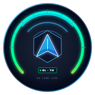
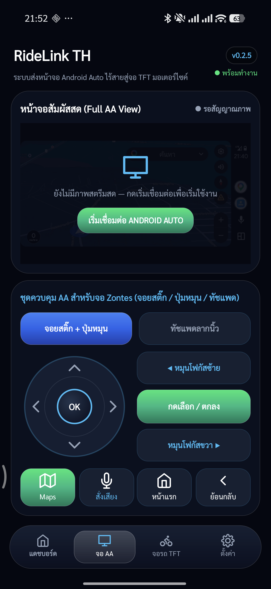
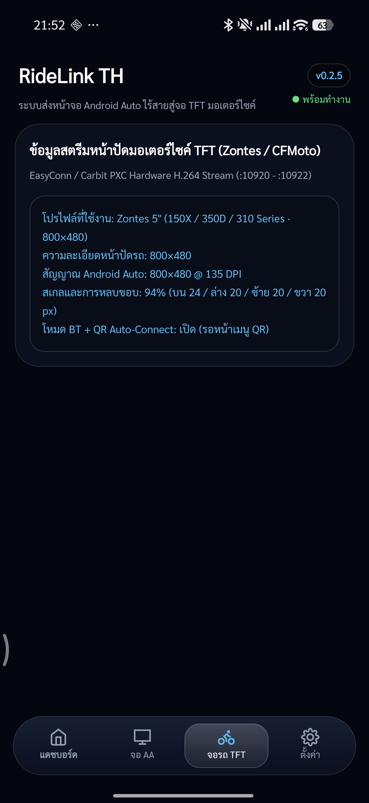
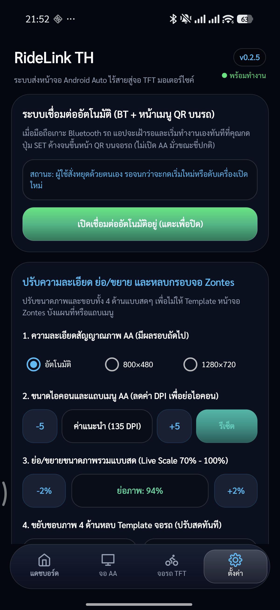
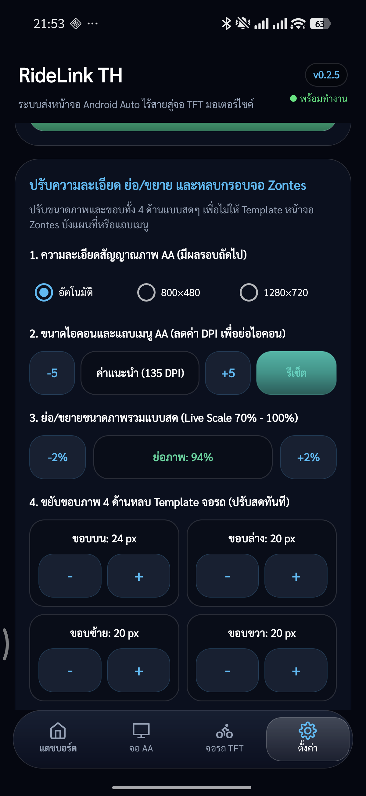

# RideLink TH (RideLinkไทย)

<p align="center">
  
</p>

<p align="center">
  <strong>Wireless Android Auto & Live Dashboard Projection for Motorcycle TFT Displays</strong><br />
  Stream Google Maps, Waze, Spotify, and Google Assistant — or switch to 14 customizable live dashboard themes with a built-in clock — directly on your bike's built-in TFT cluster.
</p>

<p align="center">
  <a href="https://github.com/maxplane-KKR/RideLink-Thai/releases/latest">
    
  </a>
  <a href="https://github.com/maxplane-KKR/RideLink-Thai/releases/download/v0.2.14/RideLink-Thai-v0.2.14.apk">
    
  </a>
</p>

<p align="center">
  <a href="README_TH.md">🇹🇭 อ่านคู่มือภาษาไทย (Thai Guide)</a> •
  <a href="https://ridelink-th.pages.dev/en/">🌐 Website & Live Preview</a> •
  <a href="#-quick-download">📥 Download APK</a> •
  <a href="#key-features">Key Features</a> •
  <a href="#screenshots">Screenshots</a> •
  <a href="#quick-start-guide">Quick Start</a> •
  <a href="#supported-motorcycles">Supported Bikes</a>
</p>

---

<a id="-quick-download"></a>

## 📥 Quick Download (One-Click)

Download the pre-compiled Android package (`.apk`) directly to your phone:

* 📱 **[Download RideLink-Thai-v0.2.14.apk](https://github.com/maxplane-KKR/RideLink-Thai/releases/download/v0.2.14/RideLink-Thai-v0.2.14.apk)** — Android 10 or later
* 📦 **[All Release Versions on GitHub Releases](https://github.com/maxplane-KKR/RideLink-Thai/releases)**
* 🌐 **[Interactive Preview & Recommended OBD2 Adapters](https://ridelink-th.pages.dev/en/)**

### What's New in `v0.2.14` (`versionCode 16`)

* **Automatic Head Unit check.** Open RideLink and wait for the Android Auto handshake. The status distinguishes a reachable server from a verified connection and offers help on tap.
* **OBD2 connection recovery.** The app waits until the first frame is sent to the motorcycle, keeps the Bluetooth link open while waiting for the ECU, and retries the adapter sooner if its link drops. On-bike validation of this build is pending.
* **Send reports in one step.** Submit the report from the form or expand its details first. Reports can include a summary of the previous attempt and selected OBD2 events.

SHA-256: `bf777b4b99439638a6c136f00bc9cc45a941f114e829e90b16a0729e87ac8add`

**Updating.** Users on `0.2.11` through `0.2.13` can install `0.2.14` directly over the existing app with the same signing key. Users on `0.2.9` must uninstall the old version first because it used a different signing key. Uninstalling may remove app data and settings.

---

## 🌟 Overview

**RideLink TH** bridges modern **Android Auto** directly to motorcycle TFT displays running EasyConn / Carbit PXC mirroring protocols (such as **Zontes**, **CFMoto**, and other smart digital clusters).

Instead of basic screen-casting that mirrors your phone's lockscreen or forces portrait distortion, **RideLink TH** runs a local hardware-accelerated Android Auto receiver, renders standard landscape Android Auto Coolwalk UI, and encodes the stream into an H.264 video feed tailored to your motorcycle's native dashboard resolution and aspect ratio.

---

<a id="key-features"></a>

## 🚀 Key Features

* **🏎️ Direct Cluster Projection**: Full Android Auto experience on your dashboard (Google Maps, Waze, Spotify, YouTube Music, Phone calls, Messaging).
* **⚡ Reliable Wireless Bike Connection**: Scan the bike's QR code once, then use the single toggle button (**Connect ⇄ Stop**) on the dashboard — one tap stops the entire session cleanly.
* **🎛️ 14 Live Dashboard Themes with Live Clock**: Choose from 14 Day/Night styles (*Horizon, Sport, Racing, Touring, Neo Sport, Circuit, Endurance, Track Focus, Street Sport, Apex, Carbon Race, Minimal Black, Amber Classic, Stealth*) featuring a 24-hour live clock (`HH:mm`), GPS speed, and real-time ECU metrics via Bluetooth Classic (SPP) OBD2 adapters (RPM, Coolant Temp, ECU Voltage, Engine Load, Intake Temp, MAP, Relative Throttle).
* **🎮 Built-In Cockpit Controls (For Non-Touch Screens)**:
  * Dedicated **Virtual Joystick** (D-Pad navigation)
  * **Rotary Knob Focus** & Confirm triggers
  * **Precision Glide Trackpad** with on-screen visual cursor
* **🎯 Accurate Touch & Display Calibration**: Adjust 4-edge margins (Top, Bottom, Left, Right) and overall Scale (70%–100%) live so motorcycle gauge bezels and status bars never obscure Android Auto controls.
* **🔘 Dual-Dispatch Quick Actions**: Dedicated on-screen shortcut buttons for **Maps**, **Voice Command** (Google Assistant), **Home / App Drawer**, and **Back / Dismiss**.
* **🔋 Power Efficiency**: Adaptive framerate caps, minute-cached live dashboard rendering, background standby timeout, and low-latency hardware H.264 encoding.

---

<a id="screenshots"></a>

## 📱 Screenshots

<p align="center">
  
  
  
</p>

<p align="center">
  
  
</p>

---

<a id="quick-start-guide"></a>

## 🛠️ Quick Start Guide

### Step 1: Enable Headunit Server in Android Auto (One-Time Setup)
1. If the Head Unit Server is already running, open **RideLink TH** and wait for the automatic check. To set it up, tap the Head Unit banner and choose **Open Android Auto**.
2. Scroll to the bottom and tap **Version** repeatedly (10 times) to unlock Developer Mode.
3. Tap the **⋮** menu (top-right corner) and select **Start head unit server**, then return to RideLink TH.
4. RideLink checks automatically. When the banner says **Head Unit · Running · Ready for bike**, you can connect to the motorcycle. Tap the banner for help if Android Auto does not respond.

### Step 2: Connect to Your Motorcycle
1. Turn on the motorcycle ignition and open the **Screen Mirroring / Carbit / QR Code** menu on the TFT display.
2. When Head Unit is ready, tap **Scan Bike QR** for the first connection or to refresh the bike link. A successful scan starts the connection.
3. For a saved motorcycle, tap **Start Connection** on the Dashboard. Approve the system Wi-Fi prompt if Android shows one.
4. Open **TFT Display → Live Dashboard** to try one of the 14 live themes with the built-in clock and OBD2 gauges. You can also browse **Settings → Recommended OBD2** for adapter options.

---

<a id="supported-motorcycles"></a>

## 🏍️ Supported Motorcycles & Displays

Includes live dashboard presets for **Zontes 150X, 350D, 350E, 368D, 368E, 368G, and 368K**, along with EasyConn / Carbit PXC display support for compatible clusters. Actual compatibility depends on bike model, model year, cluster firmware, and phone settings.

---

## 🏗️ Building From Source

### Prerequisites
* Android SDK Platform 34 & Build Tools `34.0.0`
* JDK 17
* Gradle 8.9
* PowerShell (for the automated build script)

### Build APK
```bash
# Clone the repository
git clone https://github.com/maxplane-KKR/RideLink-Thai.git
cd RideLink-Thai
```

```powershell
# Run unit tests, lint, and build release APK (caches stay outside OneDrive in LocalAppData)
.\RideLink-Thai\scripts\Build.ps1 -Tasks @(':app:testReleaseUnitTest', ':app:lintAnalyzeRelease', ':app:assembleRelease')
```

Built debug APKs are copied to the parent `APK` directory if present (or `APK/` inside the repository), while intermediate Gradle and build caches are kept in `%LOCALAPPDATA%`.

---

## 📄 License & Attribution

RideLink TH is distributed under the GNU AGPLv3 License.
Portions of this project are adapted from open-source work by [OpenCfMoto](https://github.com/alexandru-radulescu/opencfmoto), [RideScreen AA](https://github.com/alexandru-radulescu/opencfmoto), and the [Headunit-Desktop / Headunit-Revived](https://github.com/f1xpl/aasdk) community. Special thanks to all motorcycle telemetry contributors.
