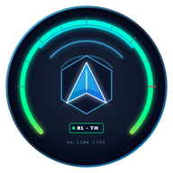
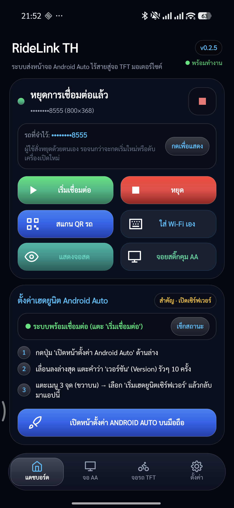
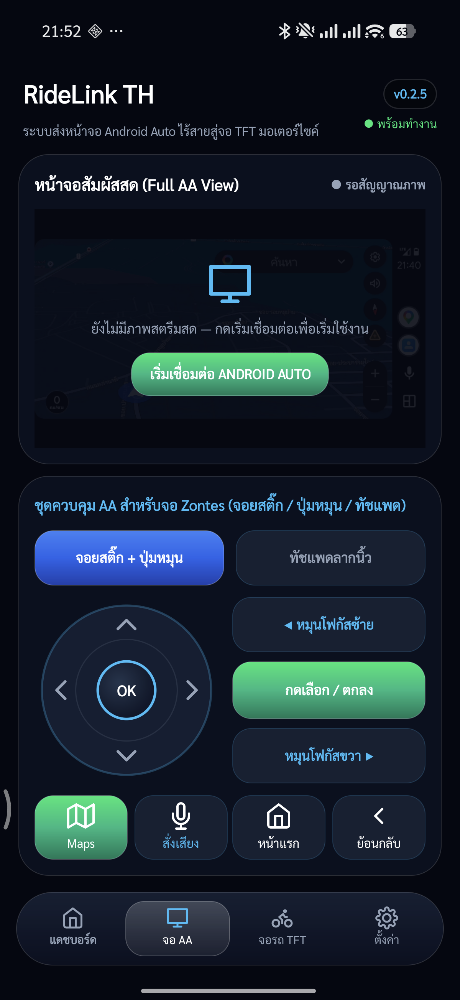
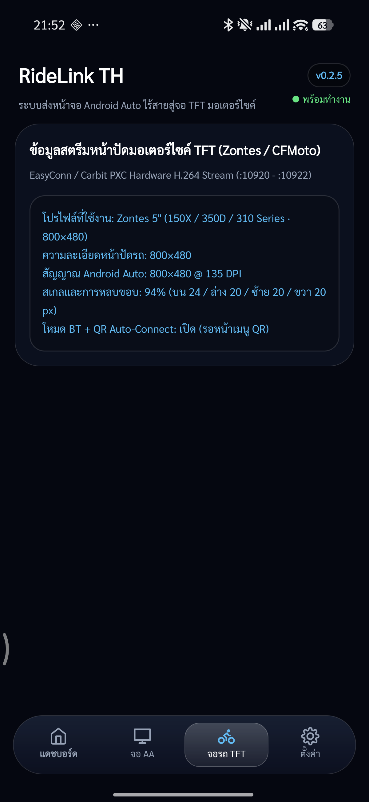
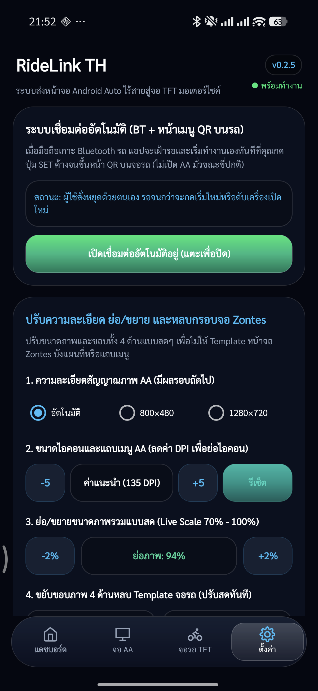
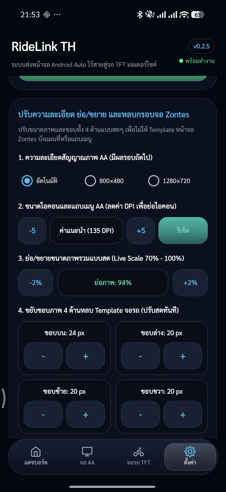

# RideLink TH (RideLinkไทย)

<p align="center">
  
</p>

<p align="center">
  <strong>Wireless Android Auto Projection for Motorcycle TFT Dashboards</strong><br />
  Stream Google Maps, Waze, Spotify, and Google Assistant directly onto your bike's built-in digital cluster — no external navigation screen required.
</p>

<p align="center">
  <a href="README_TH.md">🇹🇭 อ่านคู่มือภาษาไทย (Thai Guide)</a> •
  <a href="#key-features">Key Features</a> •
  <a href="#screenshots">Screenshots</a> •
  <a href="#how-it-works">How It Works</a> •
  <a href="#quick-start-guide">Quick Start</a> •
  <a href="#supported-motorcycles">Supported Bikes</a>
</p>

---

## 🌟 Overview

**RideLink TH** bridges modern **Android Auto** directly to motorcycle TFT displays running EasyConn / Carbit PXC mirroring protocols (such as **Zontes**, **CFMoto**, and other smart digital clusters). 

Instead of simple screen-casting that mirrors your phone's lockscreen or forces portrait distortion, **RideLink TH** spins up a local hardware-accelerated Android Auto receiver, renders standard widescreen/landscape AA Coolwalk UI, and encodes the stream into an H.264 video feed tailored to your motorcycle's native dashboard resolution and aspect ratio.

---

## 🚀 Key Features

* **🏎️ Direct Cluster Projection**: Full Android Auto experience on your dashboard (Google Maps, Waze, Spotify, YouTube Music, Phone calls, Messaging).
* **⚡ Smart Wi-Fi Watchdog & PXC Handoff**: Automatic background handshake when your bike shows its connection QR code. Never freezes or drops into dead connection loops.
* **🎮 Built-In Cockpit Controls (For Non-Touch Screens)**:
  * Dedicated **Virtual Joystick** (D-Pad navigation)
  * **Rotary Knob Focus** & Confirm triggers
  * **Precision Glide Trackpad** with on-screen visual cursor
* **🎯 1:1 Pixel-Accurate Touchscreen Mapping**: GPU Compositor coordinates guarantee every tap on the liveview hits the exact button in Android Auto.
* **🔘 Dual-Dispatch Quick Actions**: Dedicated on-screen shortcut buttons for:
  * **Maps** (Instant navigation toggle)
  * **Voice Command** (Google Assistant push-to-talk)
  * **Home / App Drawer** (Coolwalk app launcher)
  * **Back / Dismiss**
* **📐 Real-Time 4-Edge Margin & Scale Calibration**: Independently adjust Top, Bottom, Left, Right margins and overall Scale (70%–100%) live on the fly so motorcycle gauge templates and status bars never obscure Android Auto icons.
* **🔋 Power Efficiency**: Adaptive framerate caps (15–60 FPS), background battery optimization, and low-latency hardware encoding.

---

## 📱 Screenshots

<p align="center">
  
  
  
</p>

<p align="center">
  
  
</p>

---

## 🛠️ Quick Start Guide

### Step 1: Enable Headunit Server in Android Auto (One-Time Setup)
1. Open **Settings** on your Android phone and search for **Android Auto** (or tap **"เปิดหน้าตั้งค่า ANDROID AUTO"** in the app).
2. Scroll to the very bottom and tap **Version** repeatedly (around 10 times) until Developer Mode is unlocked.
3. Tap the **3 vertical dots menu** (top-right corner) and select **"Start headunit server"** (เริ่มเฮดยูนิตเซิร์ฟเวอร์).

### Step 2: Connect to Your Motorcycle
1. Turn on motorcycle ignition and navigate to the **Screen Mirroring / Carbit / QR Code** screen on the TFT dash.
2. In **RideLink TH**, tap **"เริ่มเชื่อมต่อ"** (Start Connection).
3. The app establishes the wireless link, captures the bike's gateway, and instantly forwards Android Auto live video to the dashboard.

---

## 🏍️ Supported Motorcycles & Dashboards

| Manufacturer | Models | TFT Resolution | Input Control |
| :--- | :--- | :--- | :--- |
| **Zontes** | 150X, 150D, 150M, 350D, 350M, 350T, 310 Series | 800 × 480 (5:3) | Switchgear / Virtual Joystick |
| **Zontes** | 368G ADV, 368E, 350E, 703F, 703RR | 1280 × 720 (16:9) | Switchgear / Virtual Joystick |
| **CFMoto** | 800MT, 800NK, 450MT, 450SR, 700CL-X | 800 × 480 / 1280 × 720 | Touchscreen / Handlebar buttons |
| **Moto Morini** | X-Cape 650 / 1200, Seiemmezzo | 800 × 480 | Handlebar switchgear |
| **Generic PXC** | Any motorcycle / scooter equipped with EasyConn / Carbit cluster | Auto-detected | Adaptive |

---

## 🏗️ Building From Source

### Prerequisites
* Android Studio Iguana / Jellyfish (or command-line tools)
* Android SDK 34 (Build Tools 34.0.0)
* JDK 17
* PowerShell (for automated build script)

### Build Debug APK
```bash
# Clone the repository
git clone https://github.com/maxplane-KKR/RideLink-Thai.git
cd RideLink-Thai
```

```powershell
# Using the automated build script
.\RideLink-Thai\scripts\Build.ps1

# Or via Gradle directly
cd RideLink-Thai
.\gradlew assembleDebug
```

The output APK will be generated at:
`APK/RideLink-Thai-latest.apk` or `RideLink-Thai/app/build/outputs/apk/debug/app-debug.apk`.

---

## 📄 License & Attribution

RideLink TH is distributed under the GNU AGPLv3 License.
Portions of this project are adapted from open-source research by [OpenCfMoto](https://github.com/alexandru-radulescu/opencfmoto) and the [Headunit-Desktop / Headunit-Revived](https://github.com/f1xpl/aasdk) community. Special thanks to all motorcycle telemetry contributors.
