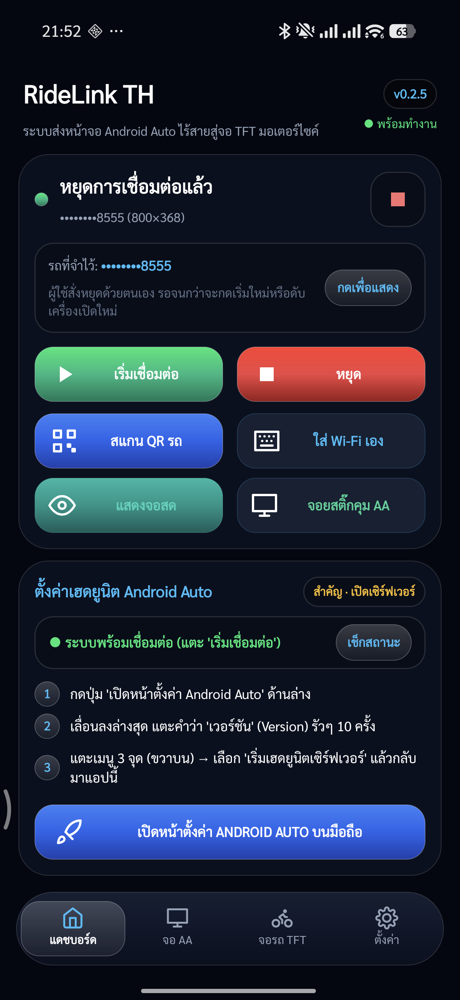

# RideLink TH (RideLinkไทย)

<p align="center">
  
</p>

<p align="center">
  <strong>Wireless Android Auto Projection for Motorcycle TFT Dashboards</strong><br />
  Stream Google Maps, Waze, Spotify, and Google Assistant directly onto your bike's built-in digital cluster — no external navigation screen required.
</p>

<p align="center">
  <a href="https://github.com/maxplane-KKR/RideLink-Thai/releases/latest">
    
  </a>
  <a href="https://github.com/maxplane-KKR/RideLink-Thai/releases/download/v0.2.11-r4/RideLink-Thai-v0.2.11-r4.apk">
    
  </a>
</p>

<p align="center">
  <a href="README_TH.md">🇹🇭 อ่านคู่มือภาษาไทย (Thai Guide)</a> •
  <a href="#-quick-download">📥 Download APK</a> •
  <a href="#key-features">Key Features</a> •
  <a href="#screenshots">Screenshots</a> •
  <a href="#quick-start-guide">Quick Start</a> •
  <a href="#supported-motorcycles">Supported Bikes</a>
</p>

---

<a id="-quick-download"></a>

## 📥 Quick Download (One-Click)

Download the pre-compiled Android package (`.apk`) directly to your phone:

* 📱 **[ดาวน์โหลด RideLink-Thai-v0.2.11-r4.apk](https://github.com/maxplane-KKR/RideLink-Thai/releases/download/v0.2.11-r4/RideLink-Thai-v0.2.11-r4.apk)** สำหรับ Android 10 ขึ้นไป
* 📦 **[All Release Versions on GitHub Releases](https://github.com/maxplane-KKR/RideLink-Thai/releases)**

APK นี้มีปุ่ม **ตั้งค่า → OBD2 ที่แนะนำ → เลือกซื้อ** และแสดงเวอร์ชัน `0.2.11` ในแอป

SHA-256: `99f53e45604a22db29bdcfc67667cd4aa764ccc72253737744bd41ad815d5006`

**สำหรับผู้ใช้ 0.2.9** รุ่น 0.2.11 ใช้ลายเซ็นต่างจาก 0.2.9 จึงต้องถอนรุ่นเดิมก่อนติดตั้ง การถอนอาจลบข้อมูลและการตั้งค่าในแอป โปรดจดข้อมูลที่ต้องการเก็บก่อนดำเนินการ

---

## 🌟 Overview

**RideLink TH** bridges modern **Android Auto** directly to motorcycle TFT displays running EasyConn / Carbit PXC mirroring protocols (such as **Zontes**, **CFMoto**, and other smart digital clusters). 

Instead of simple screen-casting that mirrors your phone's lockscreen or forces portrait distortion, **RideLink TH** spins up a local hardware-accelerated Android Auto receiver, renders standard widescreen/landscape AA Coolwalk UI, and encodes the stream into an H.264 video feed tailored to your motorcycle's native dashboard resolution and aspect ratio.

---

<a id="key-features"></a>

## 🚀 Key Features

* **🏎️ Direct Cluster Projection**: Full Android Auto experience on your dashboard (Google Maps, Waze, Spotify, YouTube Music, Phone calls, Messaging).
* **⚡ เชื่อมต่อรถผ่าน Wi-Fi**: สแกน QR หรือบันทึก Wi-Fi รถ แล้วเริ่มเชื่อมต่อจากแดชบอร์ด
* **🎛️ หน้าปัดสด 14 ธีม**: แสดงความเร็วจาก GPS และข้อมูลที่ ECU รองรับผ่านตัวอ่าน OBD2
* **🎮 Built-In Cockpit Controls (For Non-Touch Screens)**:
  * Dedicated **Virtual Joystick** (D-Pad navigation)
  * **Rotary Knob Focus** & Confirm triggers
  * **Precision Glide Trackpad** with on-screen visual cursor
* **🎯 ปรับตำแหน่งการสัมผัส**: ตั้งค่าระยะขอบและตำแหน่งภาพให้เหมาะกับหน้าจอรถ
* **🔘 Dual-Dispatch Quick Actions**: Dedicated on-screen shortcut buttons for:
  * **Maps** (Instant navigation toggle)
  * **Voice Command** (Google Assistant push-to-talk)
  * **Home / App Drawer** (Coolwalk app launcher)
  * **Back / Dismiss**
* **📐 Real-Time 4-Edge Margin & Scale Calibration**: Independently adjust Top, Bottom, Left, Right margins and overall Scale (70%–100%) live on the fly so motorcycle gauge templates and status bars never obscure Android Auto icons.
* **🔋 Power Efficiency**: Adaptive framerate caps (15–60 FPS), background battery optimization, and low-latency hardware encoding.

---

<a id="screenshots"></a>

## 📱 Screenshots

<p align="center">
  
  
  
</p>

<p align="center">
  
  
</p>

---

<a id="quick-start-guide"></a>

## 🛠️ Quick Start Guide

### Step 1: Enable Headunit Server in Android Auto (One-Time Setup)
1. Open **Settings** on your Android phone and search for **Android Auto** (or tap **"เปิดหน้าตั้งค่า ANDROID AUTO"** in the app).
2. Scroll to the very bottom and tap **Version** repeatedly (around 10 times) until Developer Mode is unlocked.
3. Tap the **3 vertical dots menu** (top-right corner) and select **"Start headunit server"** (เริ่มเฮดยูนิตเซิร์ฟเวอร์).

### Step 2: Connect to Your Motorcycle
1. Turn on motorcycle ignition and navigate to the **Screen Mirroring / Carbit / QR Code** screen on the TFT dash.
2. In **RideLink TH**, tap **"เริ่มเชื่อมต่อ"** (Start Connection).
3. The app establishes the wireless link, captures the bike's gateway, and instantly forwards Android Auto live video to the dashboard.

---

<a id="supported-motorcycles"></a>

## 🏍️ รุ่นรถและหน้าจอ

แอปมีตัวเลือกหน้าปัดสดสำหรับ Zontes 150X, 350D, 350E, 368D, 368E, 368G และ 368K ความเข้ากันได้ขึ้นอยู่กับรุ่นรถ ปีรถ เฟิร์มแวร์หน้าจอ และอุปกรณ์ที่ใช้

---

## 🏗️ Building From Source

### Prerequisites
* Android Studio Iguana / Jellyfish (or command-line tools)
* Android SDK 34 (Build Tools 34.0.0)
* JDK 17
* Gradle 8.9
* PowerShell (for automated build script)

### Build Debug APK
```bash
# Clone the repository
git clone https://github.com/maxplane-KKR/RideLink-Thai.git
cd RideLink-Thai
```

```powershell
# Using the automated build script
.\RideLink-Thai\scripts\Build.ps1

```

ไฟล์ APK ล่าสุดจะอยู่ในโฟลเดอร์ `APK` ที่ระดับโฟลเดอร์แม่ของ repository หากมีอยู่แล้ว หรือใน `APK` ภายใน repository ส่วนไฟล์บิลด์ชั่วคราวอยู่ใน LocalAppData

---

## 📄 License & Attribution

RideLink TH is distributed under the GNU AGPLv3 License.
Portions of this project are adapted from open-source research by [OpenCfMoto](https://github.com/alexandru-radulescu/opencfmoto) and the [Headunit-Desktop / Headunit-Revived](https://github.com/f1xpl/aasdk) community. Special thanks to all motorcycle telemetry contributors.
