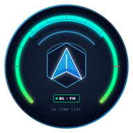
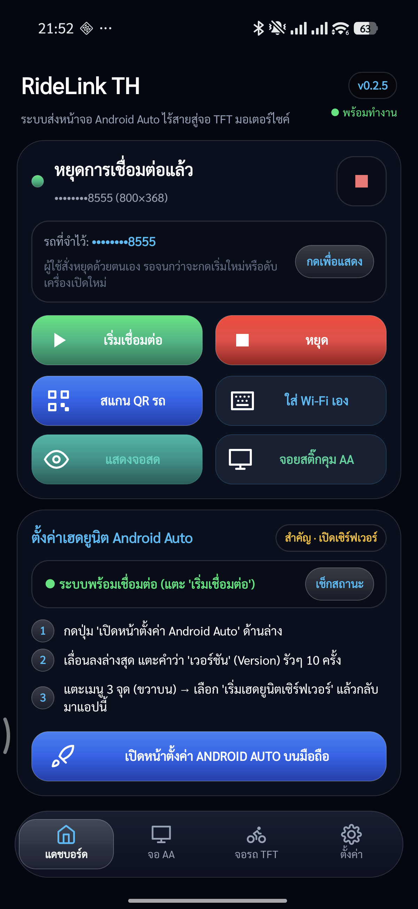
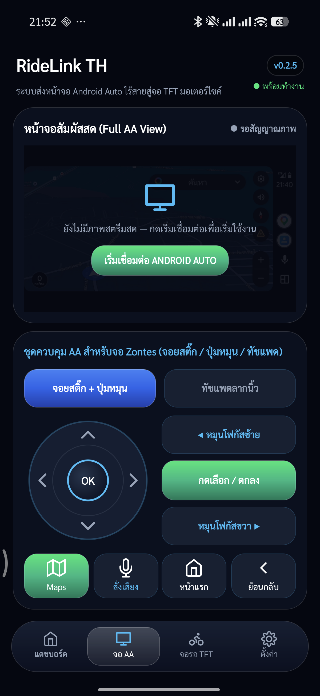
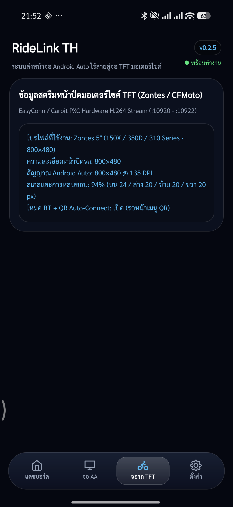
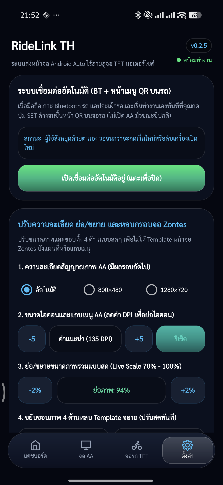
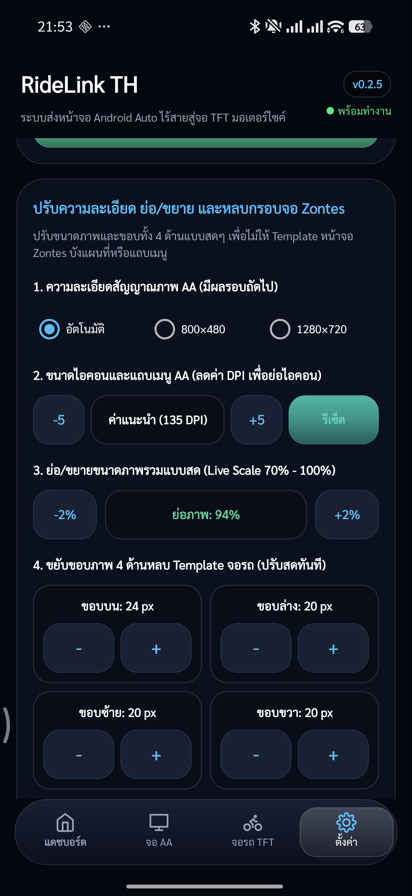

# RideLink TH (RideLinkไทย)

  

  <strong>ระบบส่งหน้าจอ Android Auto ไร้สาย สู่จอเรือนไมล์ TFT ดิจิทัลของมอเตอร์ไซค์</strong> 
  เปิด Google Maps, Waze, ฟังเพลงผ่าน Spotify / YouTube Music และสั่งงานด้วยเสียงผ่านหน้าปัดรถโดยตรง ไม่ต้องติดจอนอกเพิ่ม

  
  

  <a href="README.md">🇬🇧 English Version</a> •
  <a href="#-ดาวน์โหลดไฟล์ติดตั้ง-apk-โหลดตรงที่นี่">📥 ดาวน์โหลด APK</a> •
  <a href="#จุดเด่นและฟังก์ชันหลัก">จุดเด่น</a> •
  <a href="#ภาพหน้าจอการทำงาน">ภาพหน้าจอ</a> •
  <a href="#ขั้นตอนการเปิดใช้งานครั้งแรก">วิธีตั้งค่า</a> •
  <a href="#รุ่นรถที่รองรับการใช้งาน">รุ่นรถที่รองรับ</a>

---

## 📥 ดาวน์โหลดไฟล์ติดตั้ง APK (โหลดตรงที่นี่)

สำหรับผู้ใช้งานทั่วไป สามารถกดดาวน์โหลดไฟล์ `.apk` ไปติดตั้งในโทรศัพท์มือถือ Android ได้ทันที:

* 📱 **[👉 คลิกดาวน์โหลด RideLink-Thai-v0.2.9.apk (ไฟล์ติดตั้งหลัก แนะนำ)](https://github.com/maxplane-KKR/RideLink-Thai/releases/download/v0.2.9/RideLink-Thai-v0.2.9.apk)**
* 📦 **[ดูรายการเวอร์ชันทั้งหมด (GitHub Releases)](https://github.com/maxplane-KKR/RideLink-Thai/releases)**

---

## 🌟 ทำความรู้จัก RideLink TH

**RideLink TH** เป็นแอปพลิเคชันที่พัฒนาขึ้นเพื่อแก้ปัญหาหน้าจอสะท้อนภาพ (Screen Mirroring) เดิมของรถจักรยานยนต์ ที่มักจะทำได้แค่สะท้อนหน้าจอมือถือธรรมดา ซึ่งต้องเปิดหน้าจอมือถือค้างไว้ตลอดเวลา ภาพเป็นแนวตั้ง หรือควบคุมยาก

แอปพลิเคชันนี้ทำหน้าที่จำลองตัวเองเป็น **เฮดยูนิต Android Auto** ตัวเต็ม และแปลงสัญญาณภาพเป็นโปรโตคอล PXC (EasyConn / Carbit) ส่งตรงไปยังหน้าจอ TFT ของมอเตอร์ไซค์ผ่าน Wi-Fi:
* ได้หน้าตา **Android Auto Coolwalk** แนวนอนเต็มสเกล
* ปิดหน้าจอมือถือขณะขับขี่ได้ ช่วยประหยัดแบตเตอรี่และความร้อน
* นำทางผ่าน Google Maps ชัดเจน เลี้ยวต่อเลี้ยว พร้อมระบบแจ้งเตือนสายโทรเข้าและเพลง

---

## 🚀 จุดเด่นและฟังก์ชันหลัก

1. **ฉายภาพ Android Auto เต็มรูปแบบ**: ใช้งานแผนที่นำทาง แทร็กเพลง พอดแคสต์ และผู้ช่วยเสียง Google Assistant ได้เต็มประสิทธิภาพ
2. **ระบบ Wi-Fi Watchdog & Smart Handoff**: เชื่อมต่อแบบเบื้องหลังอัตโนมัติทันทีที่จอรถแสดง QR Code ไม่ค้าง ไม่ติดลูปหน้าจอเดิม
3. **ชุดควบคุมจอเสมือนจริง (สำหรับจอที่ไม่มีระบบทัชสกรีน เช่น Zontes)**:
   * **จอยสติ๊กจำลอง (Virtual Joystick)**: เลื่อนขึ้น-ลง-ซ้าย-ขวา เพื่อเลือกเมนู
   * **ปุ่มหมุนจำลอง (Rotary Knob Focus)**: เปลี่ยนโฟกัสหน้าจออย่างแม่นยำ
   * **ทัชแพดควบคุม (Glide Trackpad)**: มีจุดเคอร์เซอร์จำลองตำแหน่งนิ้วลากบนหน้าจอ
4. **พิกัดสัมผัสตรง 1:1 กับภาพจริง**: ปรับการคำนวณตำแหน่งสัมผัสให้ตรงกับ GPU Compositor ทำให้แตะเมนูบนหน้าจอมือถือได้ตรงจุดเสมอ
5. **ปุ่มทางลัดด่วน (Quick Actions)**:
   * **Maps**: สลับเข้าหน้าแผนที่นำทางทันที
   * **สั่งเสียง**: เรียกใช้งานคำสั่งเสียง Google Assistant
   * **หน้าแรก**: สลับกลับหน้า App Drawer / หน้าแดชบอร์ด
   * **ย้อนกลับ**: ปิดหน้าต่างหรือย้อนกลับเมนูก่อนหน้า
6. **ปรับระยะขอบจอ 4 ทิศทางอิสระ (4-Edge Calibration)**: ปรับลดขอบ บน / ล่าง / ซ้าย / ขวา และสเกลขนาดภาพ (70%–100%) แบบสดๆ เพื่อไม่ให้ภาพแผนที่หรือเมนูโดนหน้ากากและเข็มไมล์ของตัวรถบัง
7. **ประหยัดพลังงาน**: เลือกล็อกเฟรมเรตได้ (โหมดประหยัดแบตเตอรี่, ปกติ, 60 FPS) และใช้ฮาร์ดแวร์เร่งการเข้ารหัส H.264

---

## 📱 ภาพหน้าจอการทำงาน (Screenshots)

  
  
  

  
  

---

## 🛠️ ขั้นตอนการเปิดใช้งานครั้งแรก (One-Time Setup)

> [!IMPORTANT]
> ต้องเปิดโหมดนักพัฒนาของ **Android Auto** บนมือถือเพียงครั้งเดียว เพื่อให้ระบบเปิดรับการเชื่อมต่อเฮดยูนิต

### 1. เปิดเฮดยูนิตเซิร์ฟเวอร์ใน Android Auto
1. เปิดแอป **การตั้งค่า (Settings)** ของมือถือ แล้วค้นหาคำว่า **Android Auto** (หรือกดปุ่มสีฟ้า *"เปิดหน้าตั้งค่า ANDROID AUTO"* ในแอป)
2. เลื่อนลงไปล่างสุด แตะคำว่า **"เวอร์ชัน" (Version)** รัวๆ ประมาณ 10 ครั้ง จนมีข้อความแจ้งว่าเปิดโหมดนักพัฒนาแล้ว
3. แตะ **จุด 3 จุด (มุมขวาบน)** เลือก **"เริ่มเฮดยูนิตเซิร์ฟเวอร์" (Start headunit server)**

### 2. เชื่อมต่อเข้ากับหน้าจอรถมอเตอร์ไซค์
1. เปิดสวิตช์กุญแจรถ และกดเลือกเมนูเชื่อมต่อหน้าจอที่ตัวรถ (หน้ารหัส QR Code / Carbit / MotoPlay)
2. เปิดแอป **RideLink TH** แล้วกดปุ่มสีเขียว **"เริ่มเชื่อมต่อ"**
3. ระบบจะจับคู่ Wi-Fi และส่งสัญญาณภาพ Android Auto ขึ้นสู่หน้าจอ TFT ของรถโดยอัตโนมัติ

---

## 🏍️ รุ่นรถที่รองรับการใช้งาน

| แบรนด์ | รุ่นรถที่รองรับ | ความละเอียดหน้าจอ | รูปแบบการควบคุม |
| :--- | :--- | :--- | :--- |
| **Zontes** | 150X, 150D, 150M, 350D, 350M, 350T, ตระกูล 310 ทุกรุ่น | 800 × 480 (5:3) | ปุ่มสวิตช์แฮนด์ / จอยสติ๊กในแอป |
| **Zontes** | 368G ADV, 368E, 350E, 703F, 703RR | 1280 × 720 (16:9) | ปุ่มสวิตช์แฮนด์ / จอยสติ๊กในแอป |
| **CFMoto** | 800MT, 800NK, 450MT, 450SR, 700CL-X | 800 × 480 / 1280 × 720 | ทัชสกรีนบนจอรถ / สวิตช์แฮนด์ |
| **Moto Morini** | X-Cape 650, X-Cape 1200, Seiemmezzo | 800 × 480 | สวิตช์แฮนด์ของรถ |
| **รถรุ่นอื่นๆ** | หน้าจอ TFT ทุกรุ่นที่ใช้ระบบ Carbit / EasyConn PXC | ตรวจจับอัตโนมัติ | ปรับตามระบบของรถ |

---

## 💡 เทคนิคและคำแนะนำการใช้งาน

* **เปิดแผง Wi-Fi ด่วน**: หากรถเปิด QR ช้า หรือมือถือจับสัญญาณล่าช้า สามารถแตะที่แถบ **"รถที่จำไว้"** เพื่อเรียกแผงเลือก Wi-Fi ขึ้นมาต่อตรงได้ทันทีใน 1 แตะ
* **การปรับหลบเข็มไมล์**: เข้าแท็บ **"ตั้งค่า"** แล้วเลื่อนแถบ **"ขนาดภาพรวม (Scale)"** หรือปรับระยะขอบด้านบน/ล่าง เพื่อให้แถบเมนูนำทางของ Google Maps ไม่ซ้อนทับกับมาตรวัดความเร็วของตัวรถ
* **ฟังเสียงนำทางผ่านบลูทูธหมวกกันน็อก**: เชื่อมต่อมือถือเข้ากับชุดบลูทูธหมวกกันน็อก (Sena, Cardo ฯลฯ) เสียงนำทางและเพลงจะดังออกหมวกแบบชัดเจน 100%

---

## 📄 ใบอนุญาตและการพัฒนา (License)

พัฒนาต่อยอดจากโอเพนซอร์สมาตรฐานสากลภายใต้ใบอนุญาต GNU AGPLv3
อ้างอิงโปรโตคอลและโค้ดต้นแบบจากทีมงาน [OpenCfMoto](https://github.com/alexandru-radulescu/opencfmoto) และ [Headunit-Revived / AASDK](https://github.com/f1xpl/aasdk)
