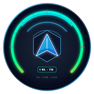
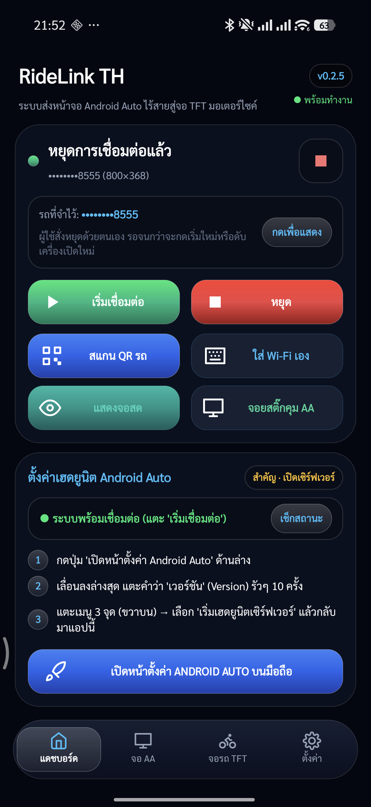
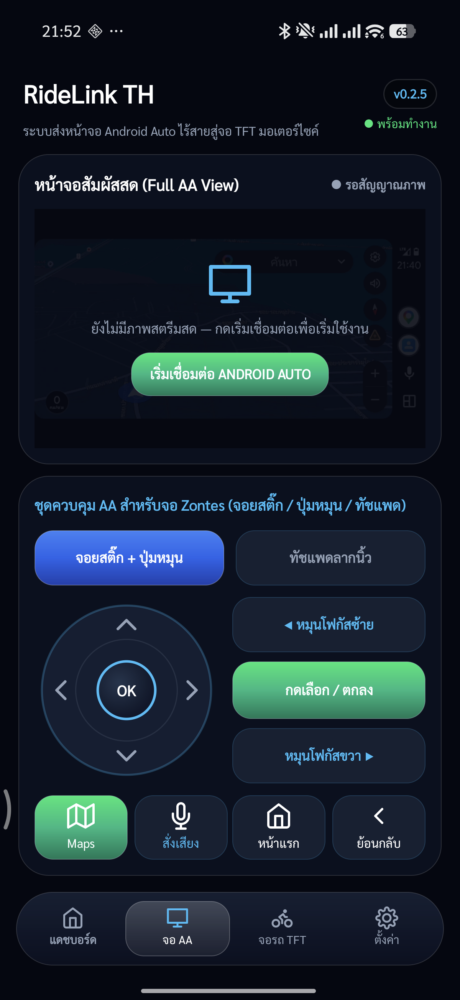
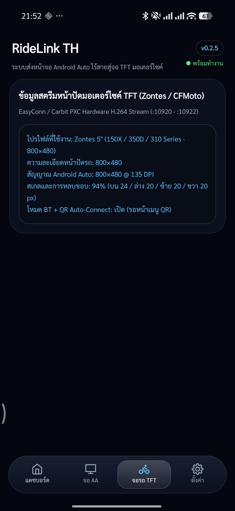
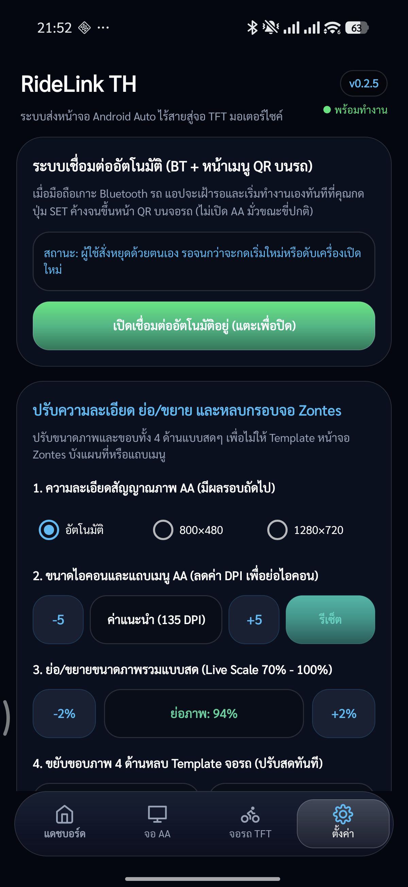
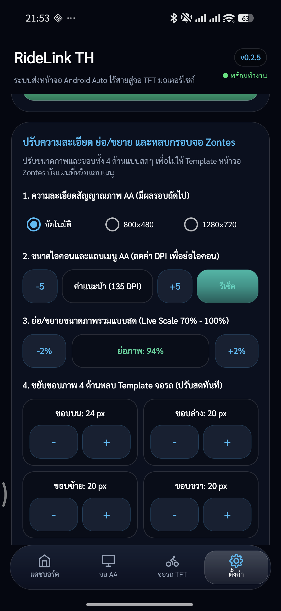

# RideLink TH (RideLinkไทย)

  

  <strong>ระบบส่งหน้าจอ Android Auto ไร้สาย และหน้าปัดสดสู่จอเรือนไมล์ TFT ของมอเตอร์ไซค์</strong> 
  เปิด Google Maps, Waze, ฟังเพลงผ่าน Spotify / YouTube Music หรือสลับเป็นหน้าปัดสด 14 ธีมพร้อมนาฬิกาบนหน้าปัดรถโดยตรง ไม่ต้องติดจอนอกเพิ่ม

  
  

  <a href="README.md">🇬🇧 English Version</a> •
  <a href="https://ridelink-th.pages.dev/">🌐 เว็บไซต์และพรีวิวหน้าปัดสด</a> •
  <a href="#-ดาวน์โหลดไฟล์ติดตั้ง-apk-โหลดตรงที่นี่">📥 ดาวน์โหลด APK</a> •
  <a href="#จุดเด่นและฟังก์ชันหลัก">จุดเด่น</a> •
  <a href="#ภาพหน้าจอการทำงาน">ภาพหน้าจอ</a> •
  <a href="#-เปิด-head-unit-และเชื่อมต่อรถ">วิธีเชื่อมต่อ</a> •
  <a href="#-หน้าปัดสด">หน้าปัดสด</a> •
  <a href="#-รุ่นรถที่มีตัวเลือกหน้าปัดสด">รุ่นรถที่มีตัวเลือก</a>

---

## 📥 ดาวน์โหลดไฟล์ติดตั้ง APK (โหลดตรงที่นี่)

สำหรับผู้ใช้งานทั่วไป สามารถกดดาวน์โหลดไฟล์ `.apk` ไปติดตั้งในโทรศัพท์มือถือ Android ได้ทันที:

* 📱 **[ดาวน์โหลด RideLink-Thai-v0.2.14.apk](https://github.com/maxplane-KKR/RideLink-Thai/releases/download/v0.2.14/RideLink-Thai-v0.2.14.apk)** สำหรับ Android 10 ขึ้นไป
* 📦 **[ดูรายการเวอร์ชันทั้งหมด (GitHub Releases)](https://github.com/maxplane-KKR/RideLink-Thai/releases)**
* 🌐 **[เว็บไซต์พรีวิวหน้าปัดสดและอุปกรณ์ OBD2 ที่แนะนำ](https://ridelink-th.pages.dev/)**

### สิ่งที่ปรับปรุงในรุ่น `0.2.14` (`versionCode 16`)

* **ตรวจ Head Unit อัตโนมัติ** เมื่อเข้า RideLink แอปแยกสถานะพบเซิร์ฟเวอร์กับพร้อมเชื่อมรถ และแสดงวิธีแก้เมื่อแตะแถบสถานะ
* **ปรับการเชื่อม OBD2** ให้รอจนส่งเฟรมแรกไปที่รถ คงลิงก์ Bluetooth ระหว่างรอ ECU และลองเชื่อมใหม่เร็วขึ้นเมื่อลิงก์หลุด รุ่นนี้ยังรอยืนยัน OBD2 บนรถจริง
* **ส่งรายงานได้ในขั้นตอนเดียว** กดส่งจากฟอร์มหรือเปิดดูรายละเอียดก่อนส่งได้ รายงานแนบสรุปรอบก่อนและเหตุการณ์ OBD2 ที่ใช้วิเคราะห์ได้

SHA-256: `bf777b4b99439638a6c136f00bc9cc45a941f114e829e90b16a0729e87ac8add`

**การอัปเดต** ผู้ใช้รุ่น `0.2.11` ถึง `0.2.13` ติดตั้งทับได้ด้วยลายเซ็นเดิม ส่วนรุ่น `0.2.9` ต้องถอนก่อนติดตั้งเพราะใช้ลายเซ็นต่างกัน การถอนอาจลบข้อมูลและการตั้งค่าในแอป

---

## 🌟 ทำความรู้จัก RideLink TH

**RideLink TH** เป็นแอปพลิเคชันที่พัฒนาขึ้นเพื่อแก้ปัญหาหน้าจอสะท้อนภาพ (Screen Mirroring) เดิมของรถจักรยานยนต์ ที่มักจะทำได้แค่สะท้อนหน้าจอมือถือธรรมดา ซึ่งต้องเปิดหน้าจอมือถือค้างไว้ตลอดเวลา ภาพเป็นแนวตั้ง หรือควบคุมยาก

แอปพลิเคชันนี้ทำหน้าที่จำลองตัวเองเป็น **เฮดยูนิต Android Auto** ตัวเต็ม และแปลงสัญญาณภาพเป็นโปรโตคอล PXC (EasyConn / Carbit) ส่งตรงไปยังหน้าจอ TFT ของมอเตอร์ไซค์ผ่าน Wi-Fi:
* ได้หน้าตา **Android Auto Coolwalk** แนวนอนเต็มสเกล หรือสลับดูหน้าปัดสด 14 ธีมพร้อมนาฬิกาและข้อมูล OBD2
* ปิดหน้าจอมือถือขณะขับขี่ได้ ช่วยประหยัดแบตเตอรี่และความร้อน
* นำทางผ่าน Google Maps ชัดเจน เลี้ยวต่อเลี้ยว พร้อมระบบแจ้งเตือนสายโทรเข้าและเพลง

---

## 🚀 จุดเด่นและฟังก์ชันหลัก

1. **ฉายภาพ Android Auto เต็มรูปแบบ**: ใช้งานแผนที่นำทาง แทร็กเพลง พอดแคสต์ และผู้ช่วยเสียง Google Assistant ได้เต็มประสิทธิภาพ
2. **เชื่อมต่อรถผ่าน Wi-Fi เสถียรขึ้น**: สแกน QR ของรถครั้งแรก แอปตรวจ Head Unit พร้อมจับคู่ Wi-Fi รถขนานกัน รถที่บันทึกแล้วสั่งเริ่มหรือหยุดได้ในปุ่มเดียว **เริ่มเชื่อมต่อ ⇄ หยุดเชื่อมต่อ** (กดหยุดครั้งเดียวจบเซสชัน) และสแกน QR ซ้ำเพื่อรีเซ็ตลิงก์รถได้ทันที
3. **หน้าปัดสด 14 ธีมพร้อมนาฬิกา 24 ชม.**: มีทั้งโหมดกลางวันและกลางคืน แสดงนาฬิกา `HH:mm`, ความเร็วจาก GPS และข้อมูลจริงจาก ECU ผ่านตัวอ่าน OBD2 Bluetooth Classic (SPP)
4. **ชุดควบคุมจอเสมือนจริง (สำหรับจอที่ไม่มีระบบทัชสกรีน เช่น Zontes)**:
   * **จอยสติ๊กจำลอง (Virtual Joystick)**: เลื่อนขึ้น-ลง-ซ้าย-ขวา เพื่อเลือกเมนู
   * **ปุ่มหมุนจำลอง (Rotary Knob Focus)**: เปลี่ยนโฟกัสหน้าจออย่างแม่นยำ
   * **ทัชแพดควบคุม (Glide Trackpad)**: มีจุดเคอร์เซอร์จำลองตำแหน่งนิ้วลากบนหน้าจอ
5. **พิกัดสัมผัสตรง 1:1 กับภาพจริง**: ปรับการคำนวณตำแหน่งสัมผัสให้ตรงกับ GPU Compositor ทำให้แตะเมนูบนหน้าจอมือถือได้ตรงจุดเสมอ
6. **ปุ่มทางลัดด่วน (Quick Actions)**: **Maps**, **สั่งเสียง**, **หน้าแรก** และ **ย้อนกลับ**
7. **ปรับระยะขอบจอ 4 ทิศทางอิสระ (4-Edge Calibration)**: ปรับลดขอบ บน / ล่าง / ซ้าย / ขวา และสเกลขนาดภาพ (70%–100%) แบบสดๆ เพื่อไม่ให้ภาพแผนที่หรือเมนูโดนหน้ากากและเข็มไมล์ของตัวรถบัง
8. **ประหยัดพลังงาน**: เลือกล็อกเฟรมเรตได้ แคชเฟรมหน้าปัดสดระดับนาที และใช้ฮาร์ดแวร์เร่งการเข้ารหัส H.264

---

## 📱 ภาพหน้าจอการทำงาน (Screenshots)

  
  
  

  
  

---

## 🛠️ เปิด Head Unit และเชื่อมต่อรถ

### 1. เปิด Head Unit ใน Android Auto

1. ถ้าเปิด Head Unit Server ไว้แล้ว ให้เปิด **RideLink TH** แล้วรอผลตรวจอัตโนมัติ หากต้องตั้งค่า ให้แตะแถบ Head Unit แล้วเลือก **เปิด Android Auto**
2. ถ้ายังไม่เห็นเมนูนักพัฒนา ให้เลื่อนลงไปแตะ **เวอร์ชัน** 10 ครั้ง แล้วกดยืนยัน ขั้นนี้ทำครั้งแรกเท่านั้น
3. แตะเมนู **⋮** มุมขวาบน เลือก **Start head unit server** แล้วกลับมาที่ RideLink แอปจะตรวจอัตโนมัติ
4. รอให้แถบด้านบนขึ้น **«Head Unit · เปิดแล้ว · รอเชื่อมต่อรถ»** แอปยืนยันสถานะจากการเชื่อมต่อ Android Auto จริง และยังอยู่ในสแตนด์บาย

หากขึ้น **«ยังติดต่อเซิร์ฟเวอร์ไม่ได้»** หรือ **«Android Auto ยังไม่ตอบ»** ให้แตะแถบเพื่อดูวิธีแก้ตามสถานะและตรวจอีกครั้ง

### 2. เชื่อมต่อกับหน้าจอรถ

1. เปิดเมนูเชื่อมต่อบนหน้าปัดรถจนเห็นหน้าคิวอาร์
2. เมื่อ Head Unit พร้อม ให้แตะ **สแกน QR รถ** หากเพิ่งเชื่อมครั้งแรกหรืออยากต่อรถใหม่ เมื่อสแกนสำเร็จแอปจะเริ่มเชื่อมเอง
3. สำหรับรถที่บันทึกไว้ ให้กด **เริ่มเชื่อมต่อ** จากแท็บ **แดชบอร์ด** หาก Android ขออนุญาตเชื่อม Wi-Fi รถ ให้กดยืนยัน

การเชื่อมต่อขึ้นอยู่กับรุ่นรถ เฟิร์มแวร์หน้าจอ และการตั้งค่าของมือถือ

---

## 🎛️ หน้าปัดสด

เปิด **จอรถ TFT → เลือกหน้าปัดสด** เพื่อเลือกหน้าปัด 14 ธีม (*Horizon, Sport, Racing, Touring, Neo Sport, Circuit, Endurance, Track Focus, Street Sport, Apex, Carbon Race, Minimal Black, Amber Classic, Stealth*) ปรับกลางวันหรือกลางคืน ช่องข้อมูล และสเกล แล้วเชื่อมรถและ Android Auto ก่อนเริ่มส่งหน้าปัดสด

ทุกธีมมี **นาฬิกา 24 ชม. (`HH:mm`)** จากเวลาบนมือถือ ความเร็วมาจาก GPS โทรศัพท์ ข้อมูลรถที่ยังไม่มีแหล่งจริงแสดง `—` และสามารถเลือกตัวอ่าน OBD2 (ดูรุ่นที่แนะนำได้ที่ **ตั้งค่า → OBD2 ที่แนะนำ → เลือกซื้อ**) เพื่ออ่านข้อมูลที่ ECU ของรถรองรับ

ปุ่มสีแดง **หยุดฉาย / กลับหน้าจอรถ** หยุดการฉายภาพ หากมีไฟล์ต้นฉบับในแอปจะตรวจและเตรียมสำเนาใน `Download/RideLink` โดยไม่เขียนลงรถ สถานะในแอปไม่ได้ยืนยันว่าจอรถเปลี่ยนสำเร็จ

หากต้องตรวจปัญหา ให้เปิด **จอรถ TFT → แจ้งปัญหาการเชื่อมต่อ** เพื่อคัดลอกหรือส่งรายงานช่วยตรวจอาการ (แอปซ่อนรหัสผ่านและข้อมูล Wi-Fi อัตโนมัติ)

---

## 🏍️ รุ่นรถที่มีตัวเลือกหน้าปัดสด

มีตัวเลือก Zontes 150X, 350D, 350E, 368D, 368E, 368G และ 368K แอปใช้ข้อมูล QR และขนาดที่รถส่งเพื่อเลือกค่าตั้งต้นเมื่อมีหลักฐาน หากรหัสใช้ร่วมกันอาจระบุชื่อรุ่นย่อยไม่ได้ บางรุ่นยังใช้การตรวจอัตโนมัติเดิม

ความเข้ากันได้ขึ้นอยู่กับรุ่นรถ ปีรถ เฟิร์มแวร์หน้าจอ และอุปกรณ์ที่ใช้

---

## 💡 เทคนิคและคำแนะนำการใช้งาน

* **มือถือ HyperOS / MIUI ที่เคยเชื่อม Wi-Fi รถด้วยมือ**: แนะนำกดลืมเครือข่าย Wi-Fi ของรถในหน้าตั้งค่า Wi-Fi ของเครื่องครั้งหนึ่ง เพื่อให้แอปจัดการเชื่อมต่อผ่าน `WifiNetworkSpecifier` ได้เต็มที่โดยไม่ติดสถานะปิดใช้งานเครือข่ายไม่มีอินเทอร์เน็ตของระบบ
* **การปรับหลบเข็มไมล์**: เข้าแท็บ **"ตั้งค่า"** แล้วเลื่อนแถบ **"ขนาดภาพรวม (Scale)"** หรือปรับระยะขอบด้านบน/ล่าง เพื่อให้แถบเมนูนำทางของ Google Maps ไม่ซ้อนทับกับมาตรวัดความเร็วของตัวรถ
* **ฟังเสียงนำทางผ่านบลูทูธหมวกกันน็อก**: เชื่อมต่อมือถือเข้ากับชุดบลูทูธหมวกกันน็อก (Sena, Cardo ฯลฯ) เสียงนำทางและเพลงจะดังออกหมวกแบบชัดเจน 100%

---

## 📄 ใบอนุญาตและการพัฒนา (License)

พัฒนาต่อยอดจากโอเพนซอร์สมาตรฐานสากลภายใต้ใบอนุญาต GNU AGPLv3
อ้างอิงโปรโตคอลและโค้ดต้นแบบจากทีมงาน [OpenCfMoto](https://github.com/alexandru-radulescu/opencfmoto) และ [Headunit-Revived / AASDK](https://github.com/f1xpl/aasdk)
